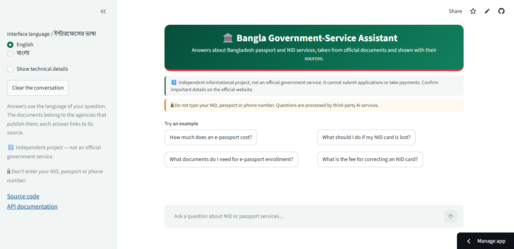
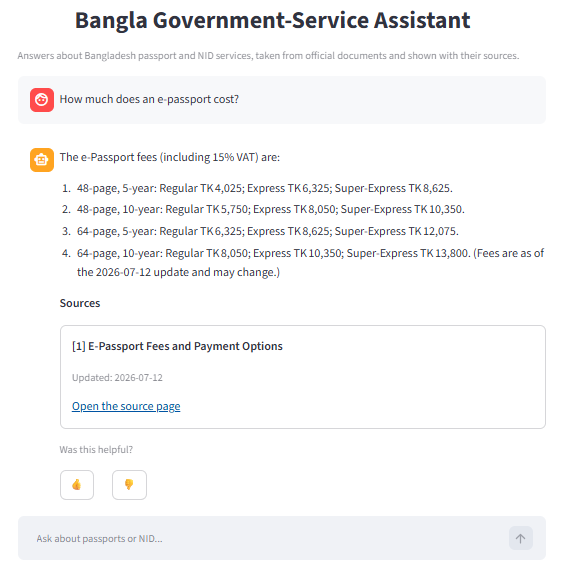
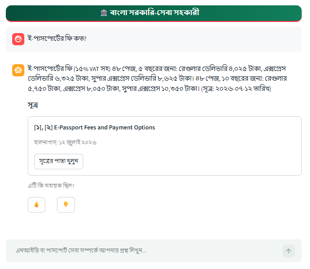
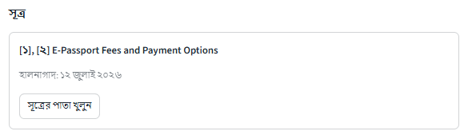
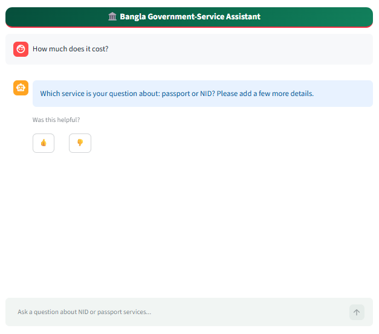
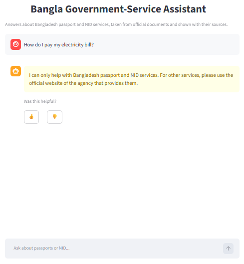
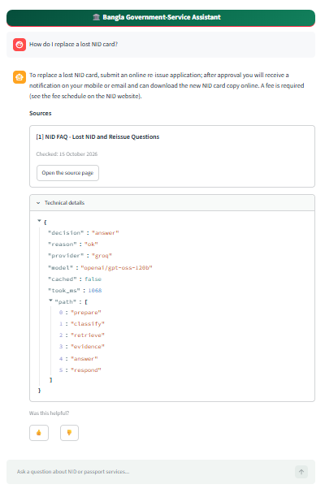
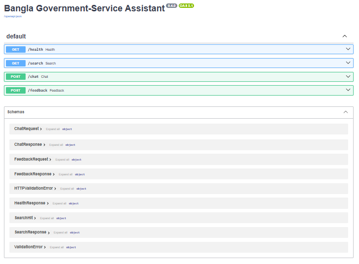
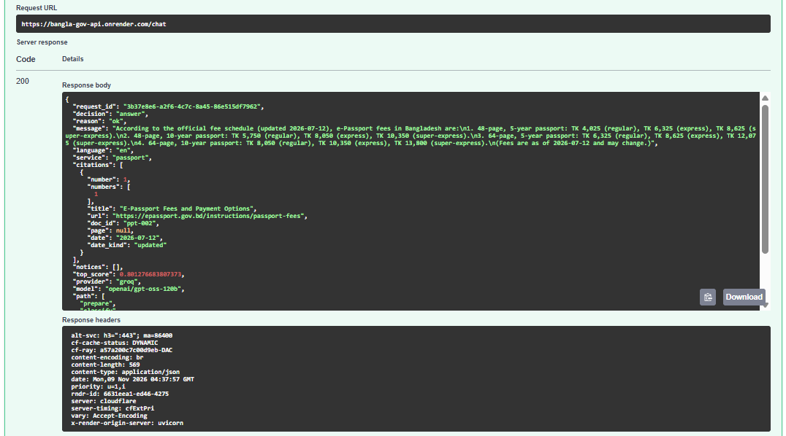
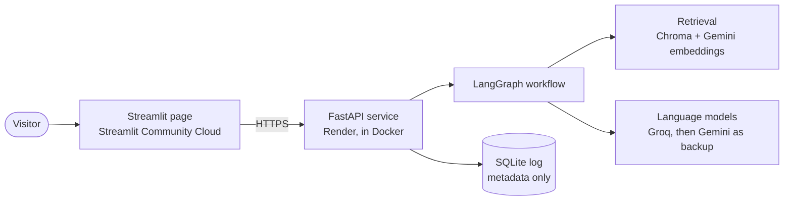

<p align="center">
  
</p>

<p align="center">
  <a href="https://github.com/ShaifulPalash/bangla-government-service-assistant/actions/workflows/ci.yml"></a>
  
  
  <a href="https://bangla-gov-assistant.streamlit.app"></a>
</p>

A bilingual (Bangla and English) assistant that answers questions about Bangladesh **passport** and **NID** services
using official documents. Every answer shows its sources and their dates, and the assistant refuses or asks a
question back when the evidence is weak, instead of guessing.

> This is an independent informational project, **not an official government service**. It cannot submit
> applications or take payments. Please confirm important details on the official websites.

**Live demo:** [bangla-gov-assistant.streamlit.app](https://bangla-gov-assistant.streamlit.app) ·
**API:** [bangla-gov-api.onrender.com/docs](https://bangla-gov-api.onrender.com/docs)

> Both run on free hosting and go to sleep when idle. The first visit can take a minute or two to wake up.

## Why this project

Passport, NID, and fee information is spread across government websites, PDFs, and notices. Citizens struggle to
find the right instruction, to read it in their own language, or to tell whether it is current. General chatbots can
answer with unsupported or outdated details, which can lead to a wrong application or a wasted trip to an office.
This assistant answers only from a curated set of official documents and shows where each answer came from.

## Features

- Questions in **English, Bangla, and Bangla typed in English letters**; answers come back in the language of the question
- **Cited answers**: every answer links to its source document with the date it was updated or checked
- **Refusals and clarifying questions**: out-of-scope topics are refused, unclear questions get "passport or NID?"
- **Safety**: personal numbers (NID, passport, phone) are removed before anything is sent to a model; attempts to
  override the rules or to ask for someone else's data are refused
- **Number check**: an answer is dropped if it contains a figure that does not appear in its sources
- **Low token use**: cheap rules run before any model call, only 3 short passages are sent, and repeated questions
  are answered from a cache
- **Fallback**: Groq answers first; Gemini takes over if Groq fails, is slow, or sends an unreadable reply
- A privacy-safe request log: it stores outcomes and timings, never the question text

## Screenshots

| | |
|---|---|
|  |  |
|  |  |
|  |  |
|  |  |
|  |  |

## How it works



The workflow decides, step by step, whether to answer, ask for clarification, or refuse. The cheap steps come first,
so many questions never reach a language model. See the [full workflow diagram](docs/workflow.md).

1. **Prepare**: replace personal numbers with placeholders, run the safety checks, detect the language
2. **Classify**: passport, NID, both, or unclear; refuse topics outside the project's scope
3. **Retrieve**: meaning search over 192 passages, limited to the service
4. **Check the evidence**: a weak best match means clarify (service unclear) or refuse (service named)
5. **Answer**: a short prompt with 3 passages; the reply must be valid JSON with citations
6. **Verify**: citations must point at real passages, and every number must appear in the sources

## Technology and why

| Part | Choice | Reason |
|---|---|---|
| Embeddings | Gemini `gemini-embedding-2`, 768 dimensions | works across Bangla and English; free tier |
| Vector store | ChromaDB | persistent, small (index is about 4 MB), easy to ship in a Docker image |
| Retrieval | meaning search | on the development questions it found the right document first every time; the keyword and hybrid variants did worse |
| Language model | Groq `gpt-oss-120b`, Gemini `3.5-flash-lite` as backup | in a 10-question comparison Groq was fastest and invented no numbers |
| Workflow | LangGraph | explicit, testable steps instead of one long prompt |
| API | FastAPI with Pydantic | validation, automatic documentation, clear errors |
| Page | Streamlit | quick to build a chat page; bilingual interface |
| Quality | pytest (372 tests), Ruff, pre-commit, GitHub Actions | the same checks run locally and on every push |
| Packaging | Docker and docker-compose | the same image runs locally and on Render |

## Evaluation

The assistant was checked on 30 labelled questions (answerable, out of scope, ambiguous, outdated) in English, Bangla,
and Bangla typed in English letters. Twenty were used to build and tune the system (development split). Ten were kept
unseen and run **once** at the end (test split). The acceptance targets were
[written and committed before that run](docs/evaluation-targets.md).

| Metric (test split, 10 questions) | Target | Result |
|---|---|---|
| Decision accuracy (answer, clarify, or refuse as labelled) | 0.80 | **0.90** |
| Refusal recall | 0.90 | **1.00** |
| Refusal precision | 0.80 | **0.67**, target missed |
| Citation accuracy | 0.80 | **0.83** |
| Answer language accuracy | 0.90 | **1.00** |

On the development split, all 20 questions ended in the labelled decision.

**What went wrong on the test split.** One answerable question was wrongly refused because its best match scored just
under the evidence threshold. One answer quoted a **Gazette page price as a fee**: the number really appeared in the
source, so the number check let it through. The cause, a price footer in the scanned Gazette text, was fixed afterwards
by the cleaning step. The test numbers above describe the system **before** that fix, and the development split was
re-checked after it. Ten questions is very small: one question moves a score by 10 points.

Results are in [`eval/results/`](eval/results). The verification notes are in
[`docs/data-verification.md`](docs/data-verification.md).

## Run it yourself

The tests run from a clean clone. **The API cannot start from a clean clone**, because the search index and the cleaned
documents are not in this repository (see [Data and sources](#data-and-sources)).

```bash
git clone https://github.com/ShaifulPalash/bangla-government-service-assistant.git
cd bangla-government-service-assistant
python3 -m venv .venv && source .venv/bin/activate
pip install -r requirements-dev.txt
cp .env.example .env        # then add GEMINI_API_KEY and GROQ_API_KEY (free tiers are enough)
make hooks                  # optional: run the formatting and secret checks before each commit
make test
```

To build the knowledge base, collect the documents listed in [`data/sources.yaml`](data/sources.yaml) (some pages
need a browser and were copied by hand; see the verification notes), then run:

```bash
make build-documents && make build-chunks && make embed-chunks && make build-index
```

Start the API and the page:

```bash
make up                     # Docker: API on :8000 and the page on :8501
# or, without Docker:
PYTHONPATH=src uvicorn app.api.main:app --port 8000
python3 -m venv .venv-ui && .venv-ui/bin/pip install -r ui/requirements.txt
API_URL=http://localhost:8000 .venv-ui/bin/streamlit run ui/app.py
```

Check a running API (local or deployed): `python scripts/api_smoke.py --url http://localhost:8000`

## Project layout

```
src/app/ingest/       source registry, PDF and OCR extraction, text cleaning
src/app/indexing/     chunking, embeddings, Chroma and keyword indexes
src/app/retrieval/    meaning, keyword, and hybrid search
src/app/graph/        routing, safety, evidence check, number check, LangGraph workflow
src/app/llm/          prompts, language detection, Groq and Gemini clients with fallback
src/app/api/          FastAPI endpoints, cache, rate limits, request log
src/app/evaluation/   metrics and the end-to-end evaluation
ui/                   Streamlit page and its API client
eval/                 labelled questions and saved results
docs/                 workflow diagram, evaluation targets, data verification notes
tests/unit/           372 tests
```

## Documentation

- [Methodology: what was built and why](docs/methodology.md)
- [Evaluation targets](docs/evaluation-targets.md) and [evaluation results](docs/evaluation-results.md)
- [Workflow diagram](docs/workflow.md)
- [Data verification notes](docs/data-verification.md)

## Limitations

- The knowledge base covers **only passport and NID**, from 17 documents; tax and utilities are out of scope.
- Official rules and fees change. Each answer shows its source date; always confirm on the official site.
- The model chooses which source to cite, so a citation can point to a related document of a different year.
- The scanned legal texts were only partly checked against the originals.
- The evidence threshold was tuned on 20 questions, and the margin around it is thin: one correct English question
  about a Bangla document scored below it and was refused.
- The per-visitor rate limit is approximate behind Render's proxies; the global limit is the firm protection.
- Free hosting sleeps when idle, and free-tier AI quotas are small.
- Renewal and re-issue **fees** are not stated in the collected documents, so the assistant declines those questions. It can answer which documents a re-issue needs.
- Passport fee questions that do not mention missions abroad, USD, labors, or students are answered with the inside-Bangladesh (TK) fees. Other applicant groups have separate fee tables and are answered only when the question names them.
- Answers are written by a language model. The number check catches figures that are not in the sources, but it cannot catch a sentence that goes beyond what a source states, so confirm important details on the official site.

## Data and sources

All content comes from official Bangladesh government websites; each source, its address, and the dates it was
published, updated, and checked are in [`data/sources.yaml`](data/sources.yaml). Raw files, cleaned text, and the index
are not redistributed in this repository because their reuse terms have not been reviewed. The documents belong to the
agencies that publish them. **If you represent one of them and want something removed, please
[open an issue](https://github.com/ShaifulPalash/bangla-government-service-assistant/issues).**

## License

The code is released under the [MIT License](LICENSE). The official documents it quotes are not covered by it.
