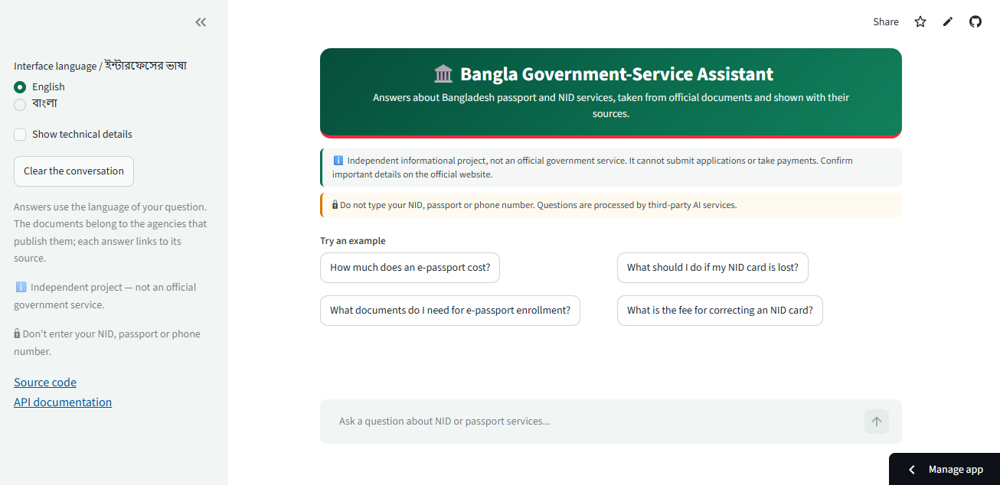
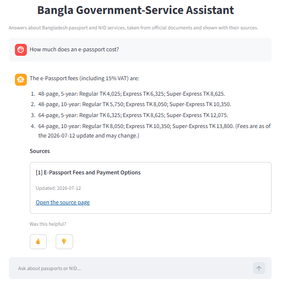
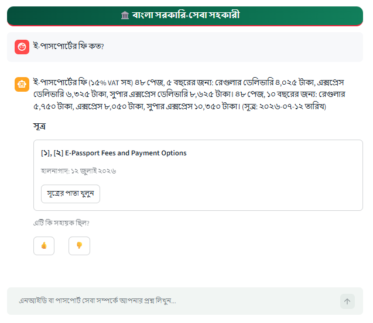
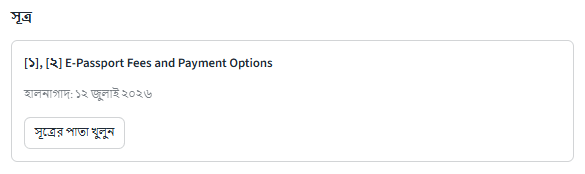
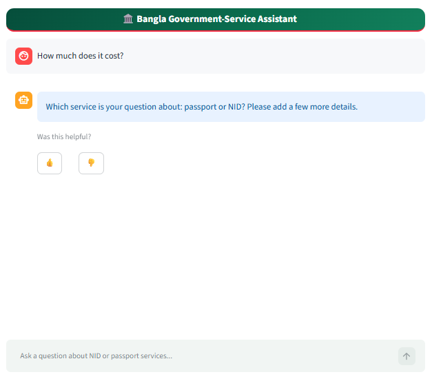
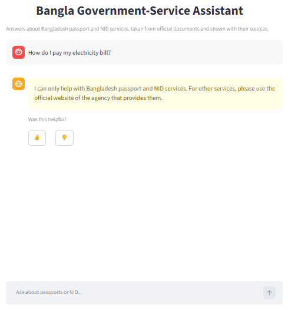
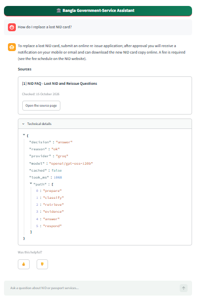
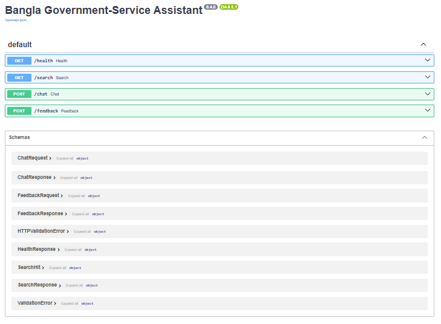
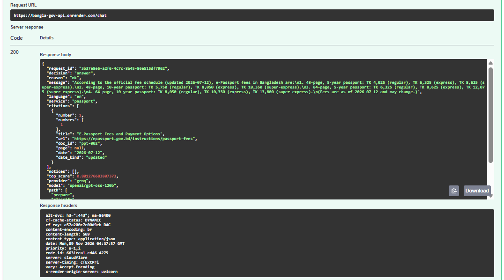
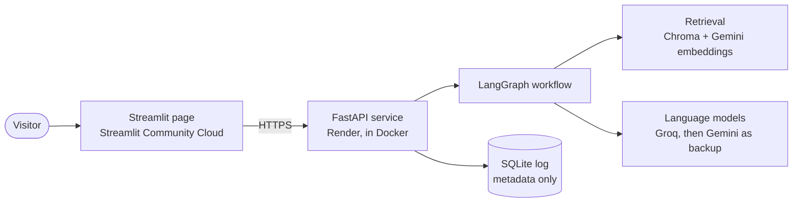

<p align="center">
  
</p>

<p align="center">
  <a href="https://github.com/ShaifulPalash/bangla-government-service-assistant/actions/workflows/ci.yml"></a>
  
  
  <a href="https://bangla-gov-assistant.streamlit.app"></a>
</p>

A bilingual (Bangla and English) assistant for questions about Bangladesh
passport and National Identity Card (NID) services. It retrieves information
from a curated collection of official government documents and provides
source citations and dates for supported answers. When evidence is insufficient
or a question is ambiguous, it asks for clarification or declines to answer
rather than guessing.

> This is an independent informational project, **not an official government service**. It cannot submit
> applications or take payments. Please confirm important details on the official websites.

**Live demo:** [bangla-gov-assistant.streamlit.app](https://bangla-gov-assistant.streamlit.app) ·
**API:** [bangla-gov-api.onrender.com/docs](https://bangla-gov-api.onrender.com/docs) ·
**Demo video:** [watch on Google Drive](https://drive.google.com/file/d/1kbLB5gBsy_-OUqhDq6H2tRuWH51kImqw/view?usp=sharing)

> Both services run on free hosting and go to sleep when idle. The first visit can take a minute or two to wake up.

## Table of contents

- [About the project](#about-the-project)
- [Features](#features)
- [Demo](#demo)
- [How it works](#how-it-works)
- [Technology stack](#technology-stack)
- [Getting started](#getting-started)
  - [Prerequisites](#prerequisites)
  - [Installation](#installation)
  - [Configuration](#configuration)
  - [Build the knowledge base](#build-the-knowledge-base)
  - [Run the app](#run-the-app)
- [Usage](#usage)
- [Testing and quality](#testing-and-quality)
- [Deployment](#deployment)
- [Project structure](#project-structure)
- [Evaluation](#evaluation)
- [Documentation](#documentation)
- [Limitations](#limitations)
- [Roadmap](#roadmap)
- [Troubleshooting](#troubleshooting)
- [Contributing](#contributing)
- [Data and sources](#data-and-sources)
- [License](#license)
- [Acknowledgements](#acknowledgements)
- [Author and contact](#author-and-contact)

## About the project

Passport, NID, and fee information is spread across government websites, PDFs, and notices. Citizens struggle to
find the right instruction, to read it in their own language, or to tell whether it is current. General chatbots can
answer with unsupported or outdated details, which can lead to a wrong application or a wasted trip to an office.

This assistant answers only from a curated set of 17 official documents (6 passport, 11 NID) and shows where each
answer came from. It covers passport and NID services only; tax and utilities are out of scope. It gives information
only: it cannot submit applications or take payments.

## Features

- Questions in **English, Bangla, and Bangla written in English letters**; answers are generated in the detected language
- **Cited answers**: supported answers include links to their source documents and relevant source dates
- **Refusals and clarifying questions**: out-of-scope topics are refused, unclear questions get "passport or NID?"
- **Safety**: personal numbers (NID, passport, phone) are removed before anything is sent to a model; attempts to
  override the rules or to ask for someone else's data are refused
- **Number check**: an answer is dropped if it contains a figure that does not appear in its sources
- **Low token use**: cheap rules run before any model call, only 3 short passages are sent, and repeated questions
  are answered from a cache
- **Fallback**: Groq answers first; Gemini takes over if Groq fails, is slow, or sends an unreadable reply
- A privacy-safe request log: it stores outcomes and timings, never the question text

## Demo

- **Live page:** [bangla-gov-assistant.streamlit.app](https://bangla-gov-assistant.streamlit.app)
- **Live API documentation:** [bangla-gov-api.onrender.com/docs](https://bangla-gov-api.onrender.com/docs)
- **Video:** [Demo Video](https://drive.google.com/file/d/1kbLB5gBsy_-OUqhDq6H2tRuWH51kImqw/view?usp=sharing)

| | |
|---|---|
|  |  |
|  |  |
|  |  |
|  |  |
|  |  |

## How it works



The workflow decides, step by step, whether to answer, ask for clarification, or refuse. The cheap steps come first,
so many questions never reach a language model. See the [full workflow diagram](docs/workflow.md).

1. **Prepare**: replace personal numbers with placeholders, run the safety checks, detect the language
2. **Classify**: passport, NID, both, or unclear; refuse topics outside the project's scope
3. **Retrieve**: search the indexed knowledge base using the selected retrieval strategy, limited to the relevant service
4. **Check the evidence**: a weak best match means clarify (service unclear) or refuse (service named)
5. **Answer**: a short prompt with 3 passages; the reply must be valid JSON with citations
6. **Verify**: citations must point at real passages, and every number must appear in the sources

## Technology stack

| Part | Choice | Reason |
|---|---|---|
| Embeddings | Gemini `gemini-embedding-2`, 768 dimensions | works across Bangla and English; free tier |
| Vector store | ChromaDB | persistent, small (index is about 4 MB), easy to ship in a Docker image |
| Retrieval | Chroma vector search, BM25 keyword search, and hybrid search using reciprocal-rank fusion (RRF) | Meaning search is the default because it performed better on the development evaluation questions. |
| Language model | Groq `openai/gpt-oss-120b`, Gemini `gemini-3.5-flash-lite` as backup | Groq was fastest and did not invent any numbers in a 10-question comparison, but matched the expected answer language in 7 of 10 questions. |
| Workflow | LangGraph | explicit, testable steps instead of one long prompt |
| API | FastAPI with Pydantic | validation, automatic documentation, clear errors |
| Page | Streamlit | quick to build a chat page; bilingual interface |
| Quality | pytest (397 tests), Ruff, pre-commit, GitHub Actions | the same checks run locally and on every push |
| Packaging | Docker and docker-compose | the same image runs locally and on Render |

The reasoning behind each choice is in [`docs/methodology.md`](docs/methodology.md).

## Getting started

> **Important:** the tests run from a clean clone, but the API cannot start from one. The search index and the cleaned
> documents are not in this repository (see [Data and sources](#data-and-sources)). Build them first, as described below.

### Prerequisites

- Python 3.12 and Git
- Free API keys: [Google AI Studio](https://aistudio.google.com) (Gemini) and [Groq](https://console.groq.com)
- Docker, only if you want `make up`
- Tesseract OCR with Bangla language data, only if you re-extract the scanned PDFs

### Installation

```bash
git clone https://github.com/ShaifulPalash/bangla-government-service-assistant.git
cd bangla-government-service-assistant
python3 -m venv .venv
source .venv/bin/activate
pip install -r requirements-dev.txt
cp .env.example .env        # then add your API keys (see Configuration)
make hooks                  # optional: format and secret checks before every commit
make test
```

### Configuration

Settings are read from environment variables or from the `.env` file (never commit it).

| Variable | Required | Default | Purpose |
|---|---|---|---|
| `GEMINI_API_KEY` | yes | none | embeddings for the search, and the backup answer model |
| `GROQ_API_KEY` | recommended | none | primary answer model; without it Gemini answers |
| `GROQ_MODEL` | no | `openai/gpt-oss-120b` | primary model name |
| `GEMINI_MODEL` | no | `gemini-3.5-flash-lite` | backup model name |
| `DATABASE_PATH` | no | `data/app.sqlite3` | request log (outcomes and timings only) |
| `RATE_LIMIT_PER_MINUTE` | no | `10` | questions per visitor per minute |
| `TRUST_PROXY_HEADERS` | no | `false` | read the visitor address from a trusted proxy header |
| `PROXY_HOPS` | no | `1` | how many trusted proxies sit in front of the API |
| `API_URL` | no | the live API | address the Streamlit page calls (page only) |

`APP_ENV` and `LOG_LEVEL` are also available; see `.env.example`.

### Build the knowledge base

Run `make fetch-sources` to download the sources that are available automatically. Some pages still require manual collection; see [`docs/data-verification.md`](docs/data-verification.md). Place each manually collected source's final text where the table `FINAL_TEXT` in `src/app/ingest/documents.py` expects it, then run:

```bash
make fetch-sources
make check-sources
make build-documents && make build-chunks && make embed-chunks && make build-index
```

Embedding calls the Gemini API once per chunk and caches the results, so a rebuild only pays for changed text.

### Run the app

With Docker (API on port 8000, page on port 8501; needs `.env` and the built index):

```bash
make up
make down        # stop and remove the containers
```

Without Docker:

```bash
PYTHONPATH=src uvicorn app.api.main:app --port 8000
python3 -m venv .venv-ui && .venv-ui/bin/pip install -r ui/requirements.txt
API_URL=http://localhost:8000 .venv-ui/bin/streamlit run ui/app.py
```

## Usage

**The page.** Type a question, or click an example. Use the sidebar to switch the interface to Bangla, to show the
technical details (model, time, workflow path), or to clear the conversation. Each answer has source cards and a
feedback form.

**The API.** Interactive documentation is at `/docs`.

| Method and path | Purpose |
|---|---|
| `GET /health` | status, number of passages, embedding model |
| `GET /search?q=...&k=3&service=passport` | the best passages for a question, without an answer |
| `POST /chat` | an answer with citations: body `{"question": "..."}` |
| `POST /feedback` | feedback on an answer: body `{"request_id": "...", "rating": 1}` (or `-1`, with an optional `category`) |

```bash
curl -s -X POST http://localhost:8000/chat \
  -H "Content-Type: application/json" \
  -d '{"question": "How much does an e-passport cost?"}'
```

The reply (shortened) has these fields: `request_id`, `decision`, `reason`, `message`, `language`, `service`, `citations` (title, link, date), `notices`, optional `practical_note`, `top_score`, `provider`, `model`, `path`, `took_ms`, and `cached`.

| `decision` | Meaning |
|---|---|
| `answer` | a cited answer |
| `clarify` | the service is unclear; the assistant asks which one |
| `refuse` | out of scope, unsafe, or not found in the documents |
| `unavailable` | the search or all language models failed |

A too-short or too-long question returns 422, and too many requests return 429 with a `Retry-After` header.

## Testing and quality

```bash
make lint          # Ruff checks and format check
make test          # 397 unit tests
make hooks         # install the pre-commit hooks
python scripts/api_smoke.py --url https://bangla-gov-api.onrender.com   # check a running API
```

- **CI:** GitHub Actions runs lint, the tests, and a source-registry check on every push.
- **Pre-commit:** Ruff, whitespace fixes, large-file and private-key checks, and a check that blocks strings that look
  like API keys.
- **Evaluation:** `make check-eval`, `make eval-retrieval`, and `make eval-e2e` (the last one calls the model APIs and
  is paced for the free limits). See [Evaluation](#evaluation).

## Deployment

- **API:** a Docker image built from the [`Dockerfile`](Dockerfile), on Render's free tier. The image contains the
  code and the prebuilt search index, so the live service deploys from a separate private repository that holds the
  index. Set `GROQ_API_KEY`, `GEMINI_API_KEY`, and `RATE_LIMIT_PER_MINUTE` as environment variables on the host,
  never in the code.
- **Page:** Streamlit Community Cloud, main file `ui/app.py`, Python 3.12. It installs only `ui/requirements.txt`.
- **Check a deployment:** `python scripts/api_smoke.py --url <address>`.
- Free services sleep when idle: open both a few minutes before a demo.

## Project structure

```
src/app/
  ingest/              source registry, PDF/OCR extraction, text cleaning
  indexing/            chunking, embeddings, Chroma and keyword indexes
  retrieval/           meaning, keyword, and hybrid search
  graph/               routing, safety, evidence and number checks, workflow
  llm/                 prompts, language detection, Groq/Gemini providers
  api/                 FastAPI endpoints, cache, rate limits, request log
  evaluation/          retrieval, end-to-end evaluation, metrics, model bake-off
ui/                    Streamlit app, API client, Bangla formatting
tests/unit/            397 unit tests
eval/                  labelled questions and saved evaluation results
data/sources.yaml      official source registry and metadata
scripts/               source fetching, indexing checks, smoke tests, debugging
docs/                  methodology, evaluation, workflow, verification, report
.github/workflows/     GitHub Actions CI
.devcontainer/         development container configuration
.streamlit/            Streamlit theme and app configuration
Dockerfile, docker-compose.yml, Makefile, pyproject.toml
requirements*.txt, .pre-commit-config.yaml
```

## Evaluation

The assistant was checked on 30 labelled questions (answerable, out of scope, ambiguous, outdated) in English, Bangla,
and Bangla typed in English letters. Twenty were used to build and tune the system (development split). Ten were kept
unseen and run **once** at the end (test split). The acceptance targets were
[written and committed before that run](docs/evaluation-targets.md).

| Metric (test split, 10 questions) | Target | Result |
|---|---|---|
| Decision accuracy (answer, clarify, or refuse as labelled) | 0.80 | **0.90** |
| Refusal recall | 0.90 | **1.00** |
| Refusal precision | 0.80 | **0.67**, target missed |
| Citation accuracy | 0.80 | **0.83** |
| Answer language accuracy | 0.90 | **1.00** |

On the development split, all 20 questions ended in the labelled decision.

**What went wrong on the test split.** One answerable question was wrongly refused because its best match scored just under the evidence threshold. One answer quoted a **Gazette page price as a fee**: the number really appeared in the source, so the number check let it through. A later manual test found passport fee tables for different applicant groups mixed in one answer. The Gazette-price issue was addressed by cleaning the scanned text, and the mixed-fee-table issue was addressed by ensuring every fee row carries its applicant group. The development split was re-checked after subsequent changes. The test numbers above describe the system
**before** those fixes. Ten questions is very small: one question moves a score by 10 points.

Full results are in [`docs/evaluation-results.md`](docs/evaluation-results.md) and [`eval/results/`](eval/results).

**Post-evaluation improvement.** A later manual test identified inconsistent handling of passport
renewal and re-issue fee questions. This was addressed after the test-split evaluation: the assistant
now provides a sourced notice explaining that the collected official documents do not specify a
separate renewal/re-issue fee, presents the general e-passport fee schedule with a qualification that
its applicability to renewals is not explicitly confirmed by those sources, and displays separate
practical guidance labelled as experience rather than documented official policy. This improvement
was not included in the test-split scores above.

## Documentation

- [Final report (PDF)](docs/report/final-report.pdf)
- [Methodology: what was built and why](docs/methodology.md)
- [Evaluation targets](docs/evaluation-targets.md) and [evaluation results](docs/evaluation-results.md)
- [Workflow diagram](docs/workflow.md)
- [Data verification notes](docs/data-verification.md)

## Limitations

- The knowledge base covers **only passport and NID**, from 17 documents; tax and utilities are out of scope.
- Official rules and fees change. Each answer shows its source date; always confirm on the official site.
- The collected official documents do not specify a separate passport renewal or re-issue fee. For
  these questions, the assistant presents the general e-passport fee schedule with a qualification
  that the sources do not explicitly confirm its applicability to renewals. It also displays separate
  practical guidance, clearly labelled as experience rather than documented official policy. Confirm
  applicable fees with the Department of Immigration and Passports before applying.
- The assistant can also answer which documents are required for a passport re-issue.
- Passport fee questions that do not mention overseas missions, USD fees, labour applicants, or
  students are answered using the fee schedule for applications within Bangladesh (BDT).
  Other applicant groups have separate fee tables and are answered only when the question names them.
- The model chooses which source to cite, so a citation can point to a related document of a different
  year, and it can add a detail that no source states (for example a form name). The number check does
  not catch words or single-digit numbers, so confirm important details on the official site.
- The scanned legal texts were only partly checked against the originals.
- The evidence threshold was tuned on 20 questions, and the margin around it is thin: one correct
  English question about a Bangla document scored below it and was refused.
- The per-visitor rate limit is approximate behind Render's proxies; the global limit is the firm protection.
- Free hosting sleeps when idle, and free-tier AI quotas are small.

## Roadmap

- Check answers against their sources sentence by sentence, not only figures
- A larger labelled question set, graded by more than one reader
- A lower evidence threshold when the service is named, validated on new questions
- Add authoritative renewal/re-issue fee documentation if the relevant government agency publishes it
- Expand coverage to tax and utility services

## Troubleshooting

| Symptom | Likely cause | What to do |
|---|---|---|
| The page says the server did not respond, or the first answer is slow | The free API host may be waking up or temporarily unavailable | Wait briefly and retry. If the problem continues, check the API `/health` endpoint and the Render service status and logs. |
| HTTP 429 | Too many requests or a rate limit has been reached | Wait for the duration specified in the `Retry-After` response header before trying again. |
| `Vector index not found` | The search index has not been built | Run `make build-index` after building the documents and embeddings. |
| An error says the index was built with another model or embedding dimension | The embedding model or its configuration has changed | Rebuild the embeddings with `make embed-chunks`, then rebuild the indexes with `make build-index`. |
| `decision: unavailable` | The search system or both language-model providers failed | Check the API keys, provider availability, network connection, and free-tier quotas. |
| A commit stops after "files were modified by this hook" | A pre-commit hook automatically fixed one or more files | Review the changes, stage the intended files with `git add`, and run the commit command again. |

## Contributing

Bug reports and suggestions are welcome as [issues](https://github.com/ShaifulPalash/bangla-government-service-assistant/issues).
To change the code:

1. Make a branch for each change (`feat/...`, `fix/...`, `docs/...`, `chore/...`).
2. Use short, conventional commit messages (`feat:`, `fix:`, `docs:`, `test:`, `chore:`).
3. Run `make format`, `make lint`, and `make test` before committing. The pre-commit hooks run the formatting and
   secret checks for you.
4. Never commit `.env` or an API key.

## Data and sources

All content comes from official Bangladesh government websites; each source, its address, and the dates it was
published, updated, and checked are in [`data/sources.yaml`](data/sources.yaml). Raw files, cleaned text, and the index
are not redistributed in this repository because their reuse terms have not been reviewed. The documents belong to the
agencies that publish them. **If you represent one of them and want something removed, please
[open an issue](https://github.com/ShaifulPalash/bangla-government-service-assistant/issues).**

## License

The code is released under the [MIT License](LICENSE). The official documents it quotes are not covered by it.

## Acknowledgements

- The AI and ML Engineering Bootcamp at Ostad, where this was built as a capstone project
- The Bangladesh government agencies that publish the documents used here
- Free tiers of Google AI Studio (Gemini), Groq, Render, and Streamlit Community Cloud
- The open-source projects it stands on, including LangGraph, FastAPI, ChromaDB, Streamlit, Pydantic, and pytest

## Author and contact

**Shaiful Islam**: [github.com/ShaifulPalash](https://github.com/ShaifulPalash). For questions, bugs, or removal
requests, please [open an issue](https://github.com/ShaifulPalash/bangla-government-service-assistant/issues).
