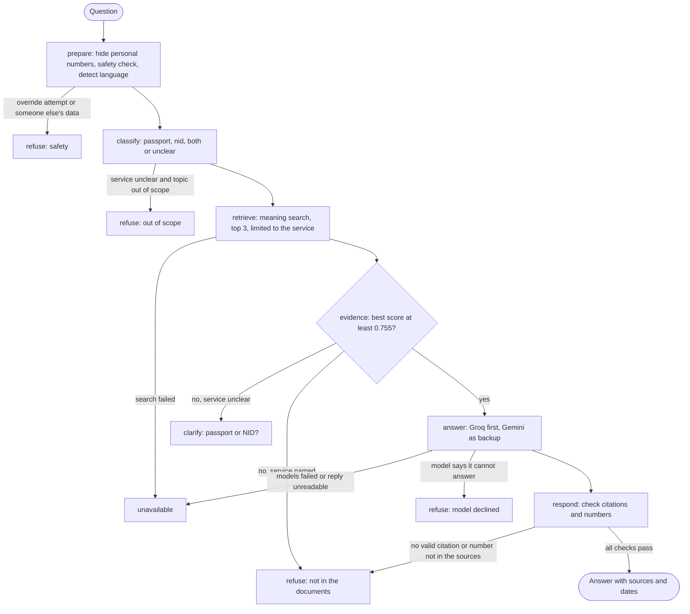

# Question-answering workflow

Every question goes through the steps below. The cheap steps come first, so many
questions end without calling a language model. The workflow is built with LangGraph
(`src/app/graph/workflow.py`); each box is a node, and each arrow is a rule that is
tested in `tests/unit/test_graph_workflow.py`.

## Outcomes

| Outcome | When | Model called? |
|---|---|---|
| answer | strong evidence, valid citations, numbers found in the sources | yes |
| clarify | the service is unclear and the best passage is weak | no |
| refuse | override attempt, someone else's data, out-of-scope topic, weak evidence, model declined, or an unverifiable answer | usually no |
| unavailable | search or all language models failed | depends |